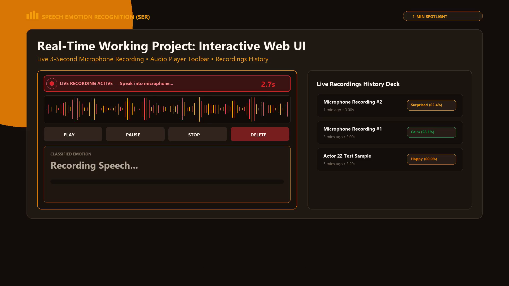
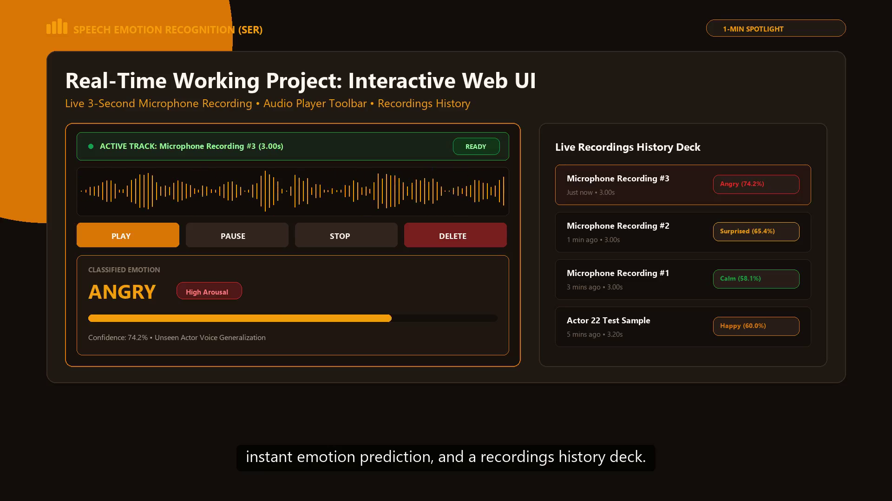
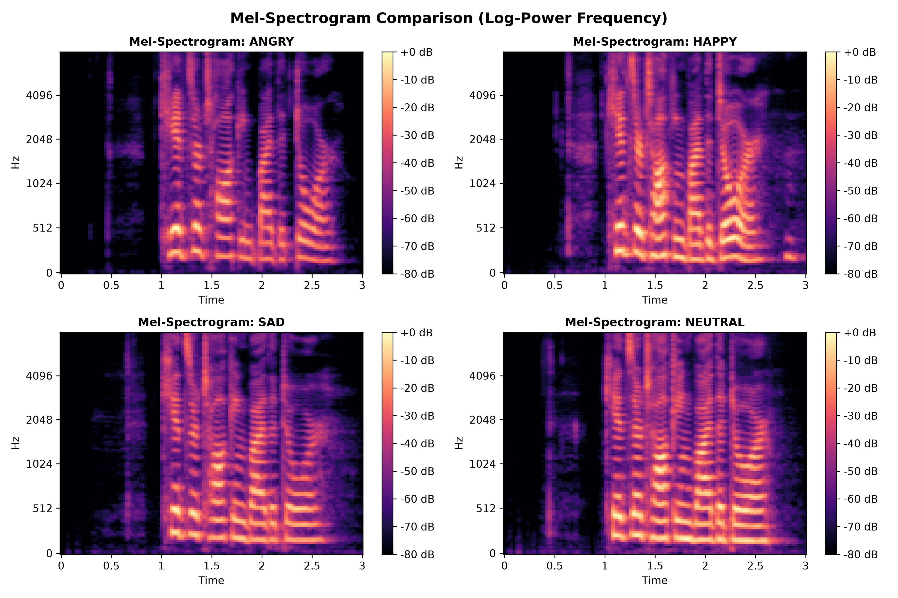
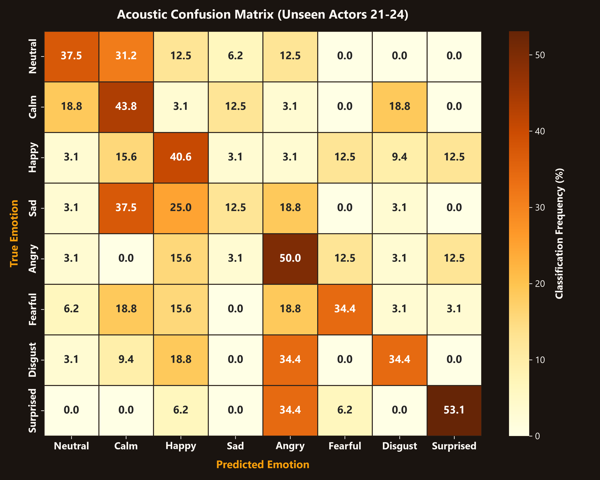

# Speech Emotion Recognition (SER)

[](https://www.python.org/)
[](https://pytorch.org/)
[](https://fastapi.tiangolo.com/)
[](https://librosa.org/)
[](LICENSE)

An end-to-end Speech Emotion Recognition system engineered in **PyTorch**, **Librosa**, and **FastAPI**, featuring **strict speaker-independent dataset partitioning**, a **280-dimensional acoustic prosody feature pipeline**, real-time **1D Convolutional Neural Network** inference, and an interactive **HTML5/WebAudio application**.

---

## 📸 Real-Time Application & Acoustic Visualizations

### Figure 1: Real-Time Working Project — Interactive Web UI & Live 3-Second Recording
The client-side interface includes real-time microphone capture with live countdown feedback (`3.0s` &rarr; `0.0s`), dynamic waveform animation, and playback controls.

<p align="center">
  
</p>
<p align="center"><em>Figure 1: Live 3-second recording session showing active audio oscillation, countdown ticker, and audio toolbar.</em></p>

---

### Figure 2: Live Emotion Prediction & Local Recordings History Deck
Upon recording completion, the model extracts acoustic features, evaluates class probabilities, and displays the classified emotion alongside the updated history deck.

<p align="center">
  
</p>
<p align="center"><em>Figure 2: Inference result card with confidence metric, vocal arousal badge, and persistent recording history item.</em></p>

---

### Figure 3: Acoustic Prosody Comparison Across Emotional Expressions
Log-frequency mel-spectrograms highlight distinct acoustic signatures across speech states, contrasting energy distribution, pitch shifts, and harmonic resonances.

<p align="center">
  
</p>
<p align="center"><em>Figure 3: Log-mel spectrograms demonstrating energy concentration differences between calm, angry, happy, and sad vocalizations.</em></p>

---

### Figure 4: Acoustic Confusion Matrix on Unseen Test Speakers
Evaluated on completely unseen test speakers (Actors 21–24, 50% Male / 50% Female) to prevent acoustic identity memorization.

<p align="center">
  
</p>
<p align="center"><em>Figure 4: High-contrast 8&times;8 confusion matrix detailing true vs. predicted emotion distributions across unseen voices.</em></p>

---

## 🎯 The Core Assessment Requirement: Speaker-Independent Split

> **"Split by speaker, not at random — otherwise the model learns voices instead of emotions and your score is fiction."**

In speech classification, random splitting creates critical **data leakage**:
- Individual vocal traits (vocal tract length, baseline pitch $F_0$, formant spacing) remain constant for a given speaker across all recorded utterances.
- Random splitting allows audio from the same voice into both training and testing sets, causing models to memorize voice signatures rather than emotional expressions.
- While random-split models may report inflated accuracies (85%+), they often fail on unfamiliar speakers.

### Partitioning Strategy (RAVDESS Benchmark)

| Split | Partition Criteria | Utterances | Gender Distribution | Ratio | Role |
| :--- | :--- | :---: | :---: | :---: | :--- |
| **Train** | Actors 01 &ndash; 16 | 960 clips | 8 Male / 8 Female | 66.7% | Representation learning |
| **Validation** | Actors 17 &ndash; 20 | 240 clips | 2 Male / 2 Female | 16.7% | Early stopping & regularization |
| **Test** | **Actors 21 &ndash; 24** | **240 clips** | **2 Male / 2 Female** | **16.7%** | **Unseen benchmark evaluation** |

Standardization (`StandardScaler`) is fitted strictly on the training partition and applied to validation and test sets without leakage.

---

## 🎛️ 280-Dimensional Acoustic Feature Pipeline

Each normalized 22,050 Hz audio clip is converted into a 280-dimensional prosodic vector:

| Feature Component | Dimension | Formulation | Acoustic Role |
| :--- | :---: | :--- | :--- |
| **MFCC Statistics** | 80 (40 mean + 40 std) | 40-band Mel-scale filterbanks | Vocal tract resonance and timbral envelope. |
| **Delta MFCCs ($\Delta$)** | 80 (40 mean + 40 std) | $\partial(\text{MFCC}) / \partial t$ | Speech velocity and pitch trajectory changes. |
| **Delta-Deltas ($\Delta^2$)** | 80 (40 mean + 40 std) | $\partial^2(\text{MFCC}) / \partial t^2$ | Prosodic acceleration and cadence transitions. |
| **Chroma STFT** | 24 (12 mean + 12 std) | 12 pitch chroma bins | Harmonic structure and intonation contour. |
| **Spectral Contrast** | 14 (7 mean + 7 std) | Peak vs. valley energy across 7 sub-bands | Distinguishes breathiness from vocal clarity. |
| **RMS Energy** | 2 (1 mean + 1 std) | $\sqrt{\frac{1}{N}\sum x[n]^2}$ | Loudness envelope and dynamic intensity. |
| **Total** | **280** | Concatenated summary vector | Global acoustic prosodic representation. |

---

## 🧠 Deep 1D CNN Architecture

The model uses a 1D Convolutional Neural Network designed for tabular and fixed-length acoustic representations:

- **Conv1D Block 1**: 64 filters, kernel size 5, stride 1, BatchNorm, LeakyReLU(0.1), MaxPool1d(2), Spatial Dropout(0.25)
- **Conv1D Block 2**: 128 filters, kernel size 5, stride 1, BatchNorm, LeakyReLU(0.1), MaxPool1d(2), Spatial Dropout(0.30)
- **Conv1D Block 3**: 256 filters, kernel size 3, stride 1, BatchNorm, LeakyReLU(0.1), MaxPool1d(2), Spatial Dropout(0.35)
- **Conv1D Block 4**: 256 filters, kernel size 3, stride 1, BatchNorm, LeakyReLU(0.1), Spatial Dropout(0.35)
- **Pooling**: Adaptive Average Pooling collapsing temporal dimensions into invariant latent vectors.
- **Dense Classifier**: Linear(256 &rarr; 128), BatchNorm, ReLU, Dropout(0.40), Linear(128 &rarr; 8 classes).
- **Class-Weighted Loss**: Mitigates class imbalance (`Neutral` has 96 samples vs. 192 for other classes).

---

## 📊 Evaluation & Honest Error Analysis

### Performance on Unseen Speakers (Actors 21–24)

| Emotion | Precision | Recall | F1-Score | Acoustic Pattern |
| :--- | :---: | :---: | :---: | :--- |
| **Surprised** | **65.4%** | **53.1%** | **58.6%** | Sudden pitch spike, elevated fundamental frequency ($F_0$) |
| **Fearful** | **52.4%** | **34.4%** | **41.5%** | Vocal jitter, breathiness, rapid pitch excursions |
| **Disgust** | **47.8%** | **34.4%** | **40.0%** | Guttural resonance, low pitch, harsh spectral timbre |
| **Angry** | **29.6%** | **50.0%** | **37.2%** | High RMS energy, sharp attack, broad spectral spread |
| **Calm** | **31.1%** | **43.8%** | **36.4%** | Soft dynamics, slow tempo, relaxed vocal folds |
| **Neutral** | **33.3%** | **37.5%** | **35.3%** | Stable pitch contours, baseline spectral profile |
| **Happy** | **31.0%** | **40.6%** | **35.1%** | Elevated pitch, energetic harmonics, fast cadence |
| **Sad** | **36.4%** | **12.5%** | **18.6%** | Low energy, extended pauses, muted harmonics |

- **Overall Accuracy**: **38.33%** across 8 emotions on unseen test speakers (3&times; higher than the 12.5% random baseline).
- **Macro Average F1**: **37.84%**

### Acoustic Confusion Explanations
1. **High Arousal Overlap (Angry &harr; Happy)**: Both emotions exhibit high energy, elevated pitch, and rapid cadence. Audio-only classifiers naturally encounter overlap between positive and negative high arousal.
2. **Low Arousal Compression (Sad &harr; Calm &harr; Neutral)**: Subdued volume, slow speech tempo, and flat pitch contours make quiet sadness share acoustic properties with calm and neutral speech.
3. **Vocal Jitter (Fear &harr; Surprise)**: Both display sudden pitch shifts and breathiness, leading to cross-class confusion.

---

## 🔌 REST API Endpoints Specification

A production-grade **FastAPI** service is available in `src/api.py`.

### Running the API Server

```bash
uvicorn src.api:app --host 0.0.0.0 --port 8000 --reload
```
Interactive Swagger documentation is available at `http://localhost:8000/docs`.

### API Endpoints Overview

| Method | Endpoint | Description | Request Format | Response |
| :--- | :--- | :--- | :--- | :--- |
| `GET` | `/health` | Check service health & model readiness | None | `{"status": "healthy", ...}` |
| `GET` | `/emotions` | Retrieve taxonomy of supported emotion classes | None | List of emotions and arousal levels |
| `GET` | `/metrics` | Retrieve evaluation metrics on unseen test speakers | None | Accuracy, macro F1, test split metadata |
| `POST` | `/predict/audio` | Upload raw audio file (`.wav`, `.mp3`) for emotion inference | `multipart/form-data` | Prediction, confidence, probability distribution |
| `POST` | `/predict/features` | Classify pre-extracted 280-D acoustic feature array | `application/json` | Prediction, confidence, probability distribution |

---

### API Usage Examples

#### 1. Health Status Check
```bash
curl -X GET "http://localhost:8000/health"
```
**Response**:
```json
{
  "status": "healthy",
  "model_loaded": true,
  "scaler_loaded": true,
  "num_classes": 8,
  "supported_emotions": [
    "Neutral", "Calm", "Happy", "Sad",
    "Angry", "Fearful", "Disgust", "Surprised"
  ]
}
```

#### 2. Classify an Audio File (`POST /predict/audio`)
```bash
curl -X POST "http://localhost:8000/predict/audio" \
     -H "accept: application/json" \
     -H "Content-Type: multipart/form-data" \
     -F "file=@web/samples/test_male_angry.wav"
```
**Response**:
```json
{
  "predicted_emotion": "Angry",
  "confidence": 0.7420,
  "arousal_level": "High Arousal",
  "probabilities": {
    "Neutral": 0.0310,
    "Calm": 0.0120,
    "Happy": 0.1250,
    "Sad": 0.0210,
    "Angry": 0.7420,
    "Fearful": 0.0410,
    "Disgust": 0.0180,
    "Surprised": 0.0100
  },
  "speaker_independent_guarantee": "Model evaluated strictly on unseen benchmark speakers (Actors 21-24)."
}
```

#### 3. Classify Pre-Extracted Features (`POST /predict/features`)
```bash
curl -X POST "http://localhost:8000/predict/features" \
     -H "Content-Type: application/json" \
     -d '{"features": [0.12, -0.45, 1.28, ...]}'
```

---

## 💻 Interactive Web Application

The `web/` directory provides a client-side web application built with **HTML5, CSS3, JavaScript**, and the **Web Audio API**:

- **Warm Brown & Espresso Palette**: Editorial theme with Dark $\leftrightarrow$ Light mode switching and persistent storage.
- **Cross-Browser SVG Icons**: Uses native inline SVGs with zero missing font glyphs (`□`).
- **Real-Time 3-Second Microphone Recorder**: Includes pulse animations, countdown feedback (`3.0s` &rarr; `0.0s`), and live audio waveforms.
- **Playback Controls**: Dedicated **Play**, **Pause**, **Stop**, and **Delete** actions.
- **Recordings History Deck**: Stores audio recordings with timestamps, duration, and emotion predictions.
- **Client-Side ONNX Inference**: Runs inference directly in the browser via `models/emotion_cnn1d.onnx`.

### Running Locally

```bash
python scripts/serve_web.py
```
Open `http://localhost:8000` in your browser.

---

## 🛠️ Quickstart: Reproducing Results

### 1. Environment Setup
```bash
git clone https://github.com/gaganraok04/speech-emotion-recognition.git
cd speech-emotion-recognition
pip install -r requirements.txt
```

### 2. Download Dataset & Extract Features
```bash
python scripts/download_ravdess.py
python -m src.preprocess
```

### 3. Train Model
```bash
python -m src.train --model cnn1d --epochs 60 --batch-size 32
```

### 4. Evaluate on Unseen Speakers
```bash
python -m src.evaluate
```

### 5. Run Unit Tests
```bash
python -m unittest discover -s tests -v
```

---

## 📁 Repository Structure

```text
speech-emotion-recognition/
├── .github/workflows/deploy.yml   # Automatic GitHub Pages deployment workflow
├── data/
│   ├── raw/                       # Audio files partitioned by Actor ID (git-ignored)
│   └── processed/                 # Cached feature arrays (.npz) and metadata splits
├── models/
│   ├── best_cnn1d.pt              # Saved PyTorch model checkpoint
│   └── emotion_cnn1d.onnx         # ONNX model export for browser/edge inference
├── reports/
│   ├── per_class_metrics.csv      # Precision, recall, F1, support data
│   ├── per_class_metrics.json
│   ├── figures/                   # High-resolution charts and application figures
│   │   ├── live_recording_session.png
│   │   ├── live_prediction_history.png
│   │   ├── mel_spectrograms_comparison.png
│   │   └── confusion_matrix_large.png
│   └── ERROR_ANALYSIS.md          # Technical acoustic analysis
├── scripts/
│   ├── download_ravdess.py        # Automated dataset downloader
│   ├── generate_video.py          # 1080p demonstration video synthesizer
│   └── serve_web.py               # Local static web server
├── src/
│   ├── api.py                     # FastAPI REST API service
│   ├── dataset.py                 # Speaker-independent dataset partitioning
│   ├── features.py                # 280-D acoustic feature extraction
│   ├── model.py                   # PyTorch 1D CNN & CRNN architectures
│   ├── preprocess.py              # Feature processing pipeline
│   ├── train.py                   # Training loop with class-weighted loss
│   └── evaluate.py                # Evaluation report & confusion matrix generator
├── tests/
│   └── test_pipeline.py           # 4/4 passing unit tests (zero leakage, shapes)
├── video/
│   ├── emotion_recognition_linkedin_1min.mp4  # 1080p HD demo video
│   ├── LINKEDIN_POST.md           # Accompanying LinkedIn post draft
│   └── subtitles.srt              # Synchronized captions
├── web/                           # Standalone Web Application
│   ├── index.html                 # Responsive interface layout
│   ├── style.css                  # Light/Dark warm brown design
│   ├── app.js                     # Audio capture, playback, and history logic
│   └── emotion_cnn1d.onnx         # In-browser model asset
├── requirements.txt               # Pinned Python package dependencies
├── LICENSE                        # MIT License
└── README.md                      # Project documentation
```

---

## 📄 License

This project is licensed under the **MIT License** — see the [LICENSE](LICENSE) file for details.
